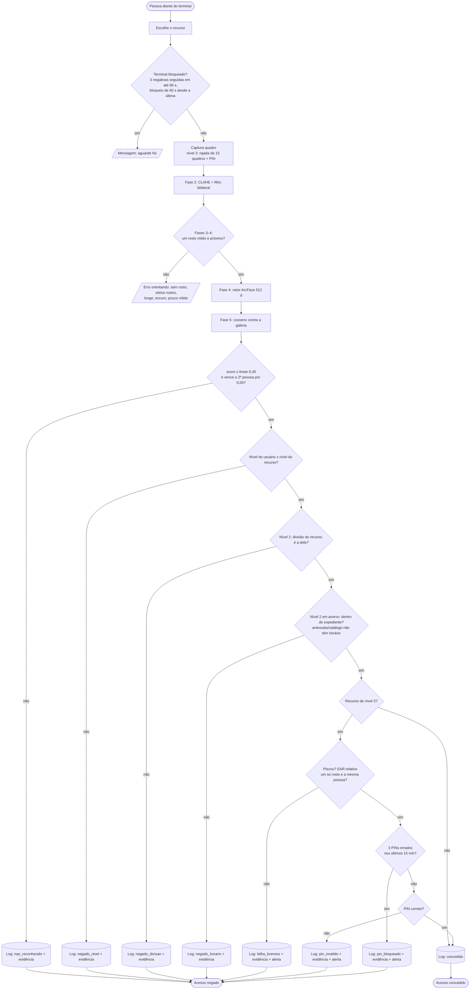

# Fluxo do sistema (APS-6)

## Tentativa de acesso (terminal do cofre)

## Módulos e contratos

| Módulo | Entrada | Saída |
|---|---|---|
| `visao/` | quadro BGR | `Resultado(vetor float32[512], bbox, qualidade)` ou `ErroVisao` |
| `core/matcher.py` | vetor | `(usuario_id \| None, score)` |
| `core/permissoes.py` | usuário, recurso, hora | `(concedido, motivo)` |
| `core/fluxo.py` | imagens, recurso, PIN | resposta JSON + registro em `acessos` |
| `api/app.py` | HTTP | JSON / CSV / PDF |
| `web/` | — | terminal, cadastro, pessoas, logs |

## Rotas da API

| Rota | Quem | Tarefa |
|---|---|---|
| `GET /api/recursos` | terminal | APS-12 |
| `POST /api/reconhecer` | terminal | APS-16 |
| `POST /api/usuarios` · `POST /api/usuarios/{id}/biometrias` | admin | APS-15 |
| `GET/PUT/DELETE /api/usuarios` | admin | APS-19 |
| `GET /api/logs` · `GET /api/alertas` · `GET /api/evidencia/{arq}` | admin | APS-18 |
| `GET /api/logs/exportar?formato=csv\|pdf` | admin | APS-19 |
| `POST /api/qualidade` · `GET /api/resumo` · `GET /api/saude` | admin / público | melhorias |

## Protótipos (APS-7 e APS-8)

Terminal: vídeo ao vivo, seletor de recurso, campo de PIN (só no nível 3), botão **Autenticar**, painel verde/vermelho com nome, nível e score.

Admin: **Cadastro** (formulário + captura de 3–5 fotos), **Pessoas** (tabela com nível, divisão, ativar/desativar, remover), **Logs** (filtros, alerta, exportar CSV/PDF). As telas implementadas em `web/` são o protótipo funcional.
